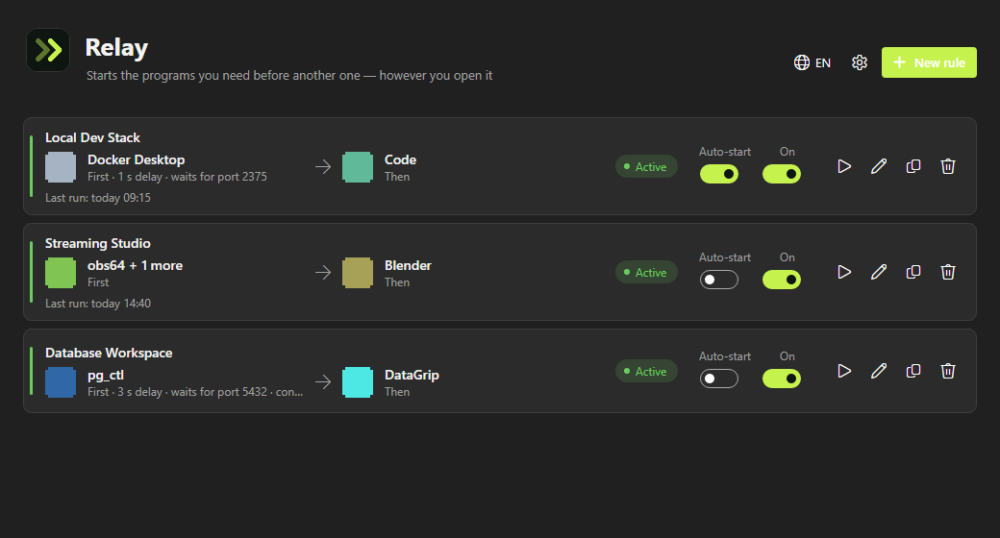
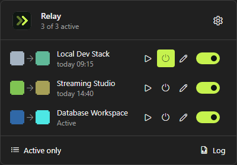

# Relay

**Automatic launch chains for Windows** — start companion tools, local services, or background utilities before any chosen app, however you open it: from a shortcut, the Start menu, File Explorer, or another program.

[English](#english) · [Русский](#русский)

  <picture>
    <source media="(prefers-color-scheme: dark)" srcset="docs/screenshots/main-dark.png">
    <source media="(prefers-color-scheme: light)" srcset="docs/screenshots/main-light.png">
    
  </picture>

---

## English

Relay automatically launches one or more prerequisite programs before a target Windows application — whether you open it from a desktop shortcut, the Start menu, File Explorer, or another app. Works with both classic `.exe` applications and Microsoft Store (MSIX) apps.

### Example workflows

- **Local Dev Stack**: start Docker Desktop and wait until its local port is ready before opening VS Code.
- **Streaming & Creative Studio**: launch OBS Studio and audio routing utilities in parallel before Blender, and close them automatically when you exit.
- **Database Workspace**: start a local PostgreSQL service and wait for port `5432` before opening DataGrip — only when connected to your office Wi-Fi and plugged in.

### Features

- **Ordered & parallel chains** with readiness checks: process launch, local TCP port (`127.0.0.1` / `::1`), active network adapter, or internet connectivity.
- **Auto-close with target app**: optionally closes launched helper programs when the main app exits (shared across rules, so a common service stays up until the last app using it closes).
- **Elevated steps without repeated UAC prompts** for administrator-protected executables (such as programs installed under `Program Files`).
- **Smart conditions**: trigger rules only on specific Wi-Fi networks, within a time window, or under a selected power state.
- **Built-in Dry-Run check**: test paths, permissions, and readiness in the rule editor without launching your apps.
- **System tray & mini-window**: toggle rules, launch on demand, manage autostart, view logs, or pause all rules temporarily.
- **5 interface languages**: English, Russian, German, French, and Simplified Chinese.
- **Light & dark themes** following Windows preferences.

  

### Installation (Windows 10 / 11 x64)

- **MSI installer (recommended)**: download `Relay-<version>-x64.msi` from [Releases](https://github.com/i23950404-create/Relay/releases). Installs Relay to `C:\Program Files\Relay`, adds a Start menu shortcut, and starts the tray app. Uninstalling cleanly removes all system hooks while keeping your rules in `C:\ProgramData\Relay`.
- **Portable**: download `Relay-<version>-x64-portable.zip` from [Releases](https://github.com/i23950404-create/Relay/releases).
- **winget**: `winget install i23950404-create.Relay` *(once published to the winget catalog)*.

> **Verification & SmartScreen:** Every release includes `SHA256SUMS.txt` so you can verify file integrity. The installer is currently unsigned, so Windows SmartScreen may show a warning on first launch — click **More info** → **Run anyway**.

### License

[Relay Freeware License](LICENSE) — free for personal and commercial use of unmodified official builds.

---

## Русский

Relay автоматически запускает цепочку вспомогательных программ или локальных сервисов перед выбранной программой в Windows — при **любом** способе её запуска: с ярлыка, из меню «Пуск», Проводника или другого приложения. Поддерживаются как обычные программы (`.exe`), так и приложения Microsoft Store (MSIX).

### Примеры сценариев

- **Локальная разработка**: запустить Docker Desktop и дождаться готовности локального порта перед открытием VS Code.
- **Стриминг и графика**: параллельно поднять OBS Studio и аудио-утилиты перед запуском Blender и автоматически закрыть их после выхода.
- **Работа с базами данных**: запустить локальный PostgreSQL и дождаться порта `5432` перед открытием DataGrip — только в офисной сети Wi-Fi и при питании от сети.

### Основные возможности

- **Последовательные и параллельные цепочки** с проверкой готовности: появление процесса, открытие локального TCP-порта (`127.0.0.1` / `::1`), активность сетевого адаптера или доступ в интернет.
- **Автозакрытие вместе с программой**: может закрывать запущенные вспомогательные программы после выхода из основной (с общим учётом: общий сервис закроется только после закрытия последней нужной ему программы).
- **Запуск от администратора без постоянного UAC** для защищённых программ (например, установленных в `Program Files`).
- **Условия срабатывания**: только в указанных сетях Wi-Fi, в заданное время или при нужном режиме питания.
- **Проверка правила (Dry-Run)**: диагностика путей, прав и готовности прямо в редакторе без запуска приложений.
- **Значок в трее и мини-окно**: быстрое включение и выключение правил, ручной запуск, автозапуск, просмотр журнала и режим паузы.
- **5 языков интерфейса**: русский, английский, немецкий, французский и китайский (упрощённый).
- **Светлая и тёмная темы** в стиле Windows.

### Установка (Windows 10 / 11 x64)

- **Установщик MSI (рекомендуется)**: скачайте `Relay-<версия>-x64.msi` со страницы [Releases](https://github.com/i23950404-create/Relay/releases). Устанавливает Relay в `C:\Program Files\Relay`, добавляет ярлык в меню «Пуск» и запускает значок в трее. При удалении снимает все системные хуки, сохраняя правила в `C:\ProgramData\Relay`.
- **Портативная версия**: скачайте `Relay-<версия>-x64-portable.zip` со страницы [Releases](https://github.com/i23950404-create/Relay/releases).
- **winget**: `winget install i23950404-create.Relay` *(после публикации пакета в каталоге winget)*.

> **Проверка файлов и SmartScreen:** В каждом выпуске есть файл `SHA256SUMS.txt` для проверки контрольных сумм. Установщик пока без цифровой подписи, поэтому при первом запуске Windows SmartScreen может показать предупреждение — нажмите **Подробнее** → **Выполнить в любом случае**.

### Лицензия

[Relay Freeware License](LICENSE) — бесплатное использование оригинальных официальных сборок в личных и коммерческих целях.
